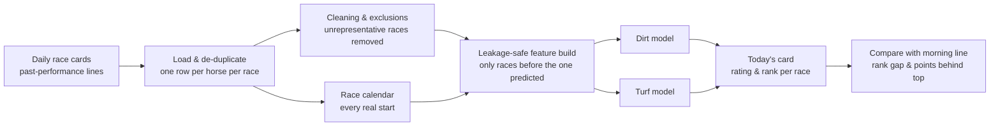

# Thoroughbred Speed Forecasting Model

A machine-learning pipeline that forecasts how fast each horse will run in an upcoming thoroughbred race, built from each horse's past performances and today's race conditions. The model forms an **independent, fundamentals-only opinion** of every runner, which is then compared with the morning line to highlight where the model and the market disagree.

> **About this repository.** This is a showcase of the project's design, methodology and results. The full pipeline, its exact feature definitions and tuned settings are proprietary and are not published here. The underlying past-performance data is licensed from a third-party provider and is not redistributed.

---

## At a glance

| | |
|---|---|
| **Task** | Forecast each runner's speed figure in today's race, then rank the field |
| **Model** | Gradient-boosted trees (LightGBM) with a quantile objective |
| **Structure** | Separate models for dirt and turf; each horse is scored by the model for today's surface |
| **Inputs** | 22 engineered features from each horse's past races and today's race conditions |
| **Data** | Over 200,000 past-performance lines across North American and international racing, built up from daily race cards |
| **Excluded by design** | Today's odds, and any hand-set post-prediction adjustments |
| **Output** | A daily prediction file per card: rating, within-race rank, gap to the top-rated horse, and comparison with the morning line |

---

## How it works

1. **Ingest.** Each day's card export, containing every entrant's recent race lines, is appended to a cumulative training file.
2. **De-duplicate.** The same past race arrives once per card a horse appears on; it is collapsed to one row per horse per race date.
3. **Race calendar.** Every real start is recorded before any filtering, so recency (days since last start, layoffs) reflects the horse's true schedule.
4. **Clean.** Races that don't represent a horse's ability (pulled up, eased, heavily beaten favourites, non-thoroughbred races and others) are removed from its figure history, while still counting as starts for recency.
5. **Build features.** Every training example is a past race, described only by information that was available before it was run.
6. **Train.** One model per surface, with time-ordered cross-validation.
7. **Predict.** Today's runners are rated, ranked within their race and compared with the morning line.

See [docs/methodology.md](docs/methodology.md) for the design decisions in detail.

---

## Key design decisions

- **Strict point-in-time features.** Each training row predicts its own race from the horse's earlier races only, mirroring exactly what is known on race day.
- **No odds as an input.** The market's opinion is deliberately kept out of the model, so the rating is an independent view that can disagree with the crowd. Odds appear only alongside the output, for comparison.
- **No hand-set corrections.** An earlier version adjusted predictions after the fact for specific trainers and jockeys. These were removed: they were fitted to the same results they were judged against, on small samples, and went stale whenever the model changed.
- **Separate surface models.** Dirt and turf form behave differently, so each surface has its own model.
- **Clean-trip targets.** Races where the horse's figure was compromised by trouble or a pace collapse are excluded as training targets, so the model learns what a horse runs given a fair trip.

---

## Feature families

The model's inputs fall into six groups. Exact definitions are proprietary; [docs/features.md](docs/features.md) describes the ideas behind them.

| Family | What it captures |
|---|---|
| **Speed and form** | Recency-weighted figure averages, recent best, form on today's surface and distance |
| **Pace** | Early and mid-race speed |
| **Class and competition** | Class movement, figures relative to class, the strength of winners faced |
| **Field quality ("key race")** | How the horses a runner faced performed next time out, a hindsight measure of race strength |
| **Margin** | How close the horse finished to the winner, scaled by the strength of the race |
| **Recency and trip** | Days since last start, layoff patterns, trouble in the previous race |

---

## Engineering highlights

Several problems found and fixed during development, each verified against independent recalculations:

- **Target misalignment.** Rolling features and the training target were offset by one race in opposite directions, so the model never trained on a horse's most recent form. Realigned so each row predicts its own race from strictly earlier races.
- **Duplicate-row leakage.** The de-duplication key included the card's track, so horses carded at more than one track kept duplicate copies of past races. Each copy's "earlier races" then contained its own twin, leaking the answer into training and flattering the validation score. The fix removed about 19,000 duplicate rows.
- **Lost races.** When a horse had a real race and a scratch on the same date, the real race was sometimes discarded. Fixed, and verified against the raw card data.
- **Stale sample weights.** Recency weights were measured from each horse's last card date instead of the prediction date, over-weighting horses that had stopped racing.
- **Training/serving mismatches.** Several features were computed with different settings or inputs in training and on race day; all now share one definition.
- **Missing values in rolling averages.** Blank races were counted in the denominator, pulling averages toward zero.

---

## Output

Each run produces one row per runner on the day's card, including:

| Column | Meaning |
|---|---|
| `pred_speed` | The model's rating for today's race |
| `model_rank` | Rank of the rating within the race |
| `pts_behind_top` | Points behind the race's top-rated horse |
| `ml_rank` / `rank_gap` | Morning-line rank, and how far the model's rank differs from it |
| Reference columns | Trainer form, the previous race's chart comment, and key feature values for review |

---

## Results

Evaluation on live, unseen races is in progress. Every card is logged before the race is run, and results will be reported here once the sample is large enough to be meaningful. The planned measures are:

- **Top-rated horse:** win and in-the-money rates, compared with the morning-line favourite
- **Confidence:** win rate by the size of the top-rated horse's lead over the second-rated horse
- **Coverage:** share of winners coming from the model's top two and top three
- **Value:** return at closing odds on horses the model ranks above their morning line
- **By surface:** each measure split by dirt and turf

Each result will state the number of races and the date range it covers.

---

## Tech stack

Python · pandas · NumPy · LightGBM · Optuna · scikit-learn

---

## About

Built by **Brett Sturman**, a financial services technology leader with more than 15 years in banking, risk, ALM and model risk management. Horse racing is a long-standing hobby, and this project applies the same disciplines I use professionally (point-in-time data, leakage control, out-of-sample validation and clear documentation) to a domain I enjoy.

Developed with the help of an AI coding assistant for code review and implementation. The modelling decisions, domain features and validation are my own.

**Contact:** reach me through my GitHub profile.
